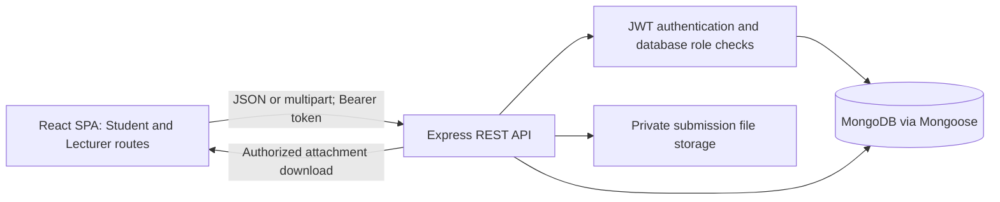
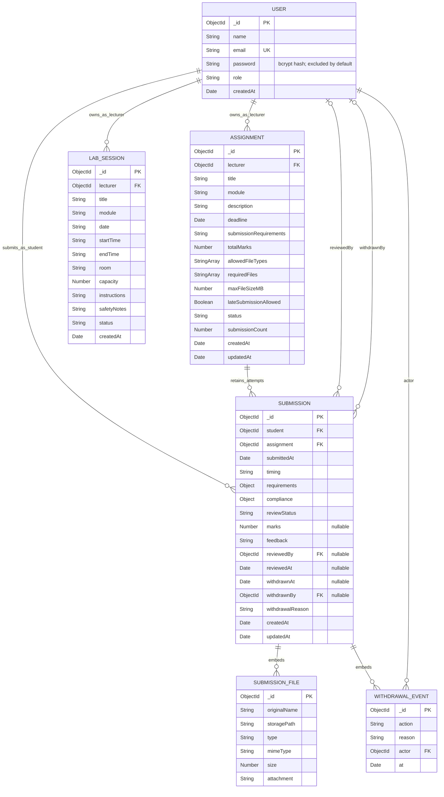

# AutoGrader & Lab Submission Portal (LabTrack)

Technical documentation — implementation inspected and automated checks rerun on **31 October 2026**.

This document describes the current repository, including existing uncommitted changes. It is not a specification for future features. No application source code, development database records or uploaded documents were changed to prepare it. Examples contain no credentials or private records.

## 1. Introduction, problem statement and objectives

LabTrack is a university laboratory coursework portal with separate Student and Lecturer workspaces. Its persistent assessment workflow covers assignment publication, student uploads, automatic submission requirement checks, lecturer review and published feedback. It also includes database-backed lab scheduling and demonstration interfaces for attendance and medical requests.

### Problem statement

Laboratory coursework needs a consistent way to distribute assignment requirements, receive multiple submission attempts, identify late or noncompliant uploads, protect student documents and return lecturer marks. Deleting or replacing attempts indiscriminately would lose academic history. Students also need to distinguish an automatic requirements check from a lecturer's final assessment.

### Implemented objectives

- Authenticate users and enforce Student/Lecturer permissions on the server.
- Let lecturers manage their own assignments and publish requirements to students.
- Persist submission attempts, file metadata, requirement snapshots and compliance results.
- Keep uploaded documents in private disk storage with authorized downloads.
- Keep draft feedback private and publish marks for the correct student and attempt.
- Support reversible withdrawal with reasons, timestamps and actor history.
- Prevent permanent assignment deletion when submission history or an upload reservation exists.
- Verify core behavior through automated tests using an isolated database.

The name **AutoGrader** currently refers to automatic submission compliance checks. The implementation does **not** execute student programs, assess report content, perform plagiarism detection or assign academic marks automatically.

## 2. Actual technology stack and architecture

### Stack

Versions below distinguish manifest ranges from versions recorded in the lockfiles; a range is not an exact installed version.

| Component | Manifest range | Lockfile version |
| --- | --- | --- |
| React | `^19.2.8` | `19.3.0` |
| React DOM | `^19.2.8` | `19.3.0` |
| React Router DOM | `^7.9.5` | `7.18.4` |
| Vite | `^8.3.0` | `8.3.0` |
| Express | `^5.1.0` | `5.3.0` |
| Mongoose | `^8.19.2` | `8.24.5` |

The frontend uses JavaScript/JSX, CSS, the Vite React plugin and ESLint. The backend uses ES modules, MongoDB, `bcryptjs`, `jsonwebtoken`, `cors`, `dotenv`, `multer`, `file-type` and `yauzl`. Tests use Node's built-in `node:test` and assertions. No separate frontend component-testing framework is declared in the frontend package.

The documentation verification environment used Node **26.9.0**, npm **11.19.1** and MongoDB **8.3.11**. These are observed versions, not a claim that every other version has been tested. The backend declares Node `>=22`; Vite's locked engine requirement means Node **22.12 or newer** is a suitable common baseline.

### Architecture



- `FrontEnd/src/App.jsx` defines routes; `auth/ProtectedRoute.jsx` gates client-side role navigation.
- `FrontEnd/src/api/` adapts REST data for pages. Authentication and other API requests share the base URL in `api/config.js`.
- `backend/src/app.js` mounts authentication, assignments, submissions and lab-session routes, security headers, CORS and error handling.
- `backend/src/server.js` loads environment configuration, connects MongoDB and starts HTTP listening.
- Controllers implement ownership, input validation and workflow rules; Mongoose models persist records.
- `backend/src/services/submissionFiles.js` handles multipart upload storage, format inspection and compliance checking.

The frontend calls the API directly across origins. `FrontEnd/vite.config.js` configures the React plugin and has **no API proxy**. The API is the source of truth for assignments, submissions, reviews and schedules. Browser local storage holds the authentication session, not persistent submission records.

## 3. Student and Lecturer modules

### Persistence boundaries

| Module | Student functionality | Lecturer functionality | Actual persistence |
| --- | --- | --- | --- |
| Accounts | Register, log in, restore session, log out | Same, with lecturer role | MongoDB users; JWT/profile cached in browser |
| Assignments | Browse published assignments, view requirements | Create, view, edit, publish, close and conditionally delete own assignments | MongoDB |
| Submissions | Upload/resubmit, view own attempt history, download own files, inspect compliance, eligible withdrawal | List own assignment submissions, search/filter, inspect files and checks | MongoDB metadata plus private disk files |
| Marks and feedback | View own published results and attempt-specific feedback | Save draft reviews, publish/update results | Fields on MongoDB submission records |
| Withdrawal | Withdraw an eligible own attempt with reason and confirmation | Withdraw/restore own assignment attempts, inspect audit history | MongoDB; files retained |
| Lab schedule | Read lab sessions and instructions | Create/edit sessions; cancel upcoming sessions or delete through schedule controls | MongoDB |
| Attendance | Static attendance history and filters | Demo attendance editing and save interactions | Static data/in-memory JavaScript store only |
| Medical requests | Demonstration request form and local history | Demo review, temporary approval/rejection and comments | React state/in-memory JavaScript store only |
| Dashboard overview | Demonstration activities and summary content | Demonstration summaries, tables and navigation | Static page content; not live database totals |

Attendance and medical requests have **no corresponding backend model or REST route** in this implementation. Student medical forms do not persist supporting documents to the server; lecturer supporting-document downloads are disabled. Lecturer demo approvals do not update a student's separate demo history. Demo changes are lost on reload and must not be described as completed persistent workflows.

Some legacy fixture modules remain under `FrontEnd/src/data/`. Their presence does not make the current assignment/submission/grading pages mock-backed: those pages import API functions. Unmatched lecturer routes render `LecturerPlaceholderPage` rather than an implemented module.

### Principal frontend routes

| Role | Routes |
| --- | --- |
| Public | `/` (login), `/register` |
| Student | `/student-dashboard`, `/student/schedule`, `/student/assignments`, `/student/assignments/:assignmentId`, `/student/submissions`, `/student/marks-feedback`, `/student/attendance`, `/student/medical-requests` |
| Lecturer | `/lecturer-dashboard`, `/lecturer/assignments`, `/lecturer/assignments/create`, `/lecturer/assignments/:assignmentId/edit`, `/lecturer/submissions`, `/lecturer/marks-feedback`, `/lecturer/schedule`, `/lecturer/attendance`, `/lecturer/medical-requests` |

Shared `TableScroll.jsx` provides a labeled, focusable horizontal scroll region when a table overflows. Shared review-panel behavior brings selected lecturer review content into view. These mechanisms are implemented; passing a build does not establish native browser layout or keyboard correctness.

## 4. MongoDB collections, schemas and relationships

Collection names were verified from the actual Mongoose models without reading development records: **`users`, `assignments`, `submissions`, `labsessions`**. All four have an automatically generated ObjectId `_id` and Mongoose's default version key `__v`. ObjectId `ref` values are application-level references, not MongoDB-enforced foreign-key constraints.

### 4.1 User → `users`

Source: `backend/src/models/User.js`.

| Field | Mongoose type | Rules/defaults |
| --- | --- | --- |
| `name` | String | Required, trimmed, minimum 2 characters; registration API additionally caps at 100 |
| `email` | String | Required, unique index, trimmed and lowercase; API validates format and length |
| `password` | String | Required, minimum length 8, excluded from ordinary queries; stored as bcrypt hash |
| `role` | String enum | Required: `student` or `lecturer` |
| `createdAt` | Date | Automatic creation timestamp; no `updatedAt` timestamp |

The save hook hashes changed passwords with bcrypt cost 12. `toSafeObject()` returns only the user ID, name, email, role and creation time. There is no separate Student, Lecturer or Administrator collection/model.

### 4.2 Assignment → `assignments`

Source: `backend/src/models/Assignment.js`.

| Field | Mongoose type | Rules/defaults |
| --- | --- | --- |
| `title` | String | Required, trimmed, maximum 150 characters |
| `module` | String | Required, trimmed, maximum 100 |
| `description` | String | Required, trimmed, maximum 5,000 |
| `deadline` | Date | Required; API accepts valid years 2000–2100 inclusive |
| `submissionRequirements` | String | Default empty string, trimmed, maximum 2,000 |
| `totalMarks` | Number | Required integer, 1–1,000 |
| `allowedFileTypes` | String array | Nonempty; `PDF`, `DOCX`, `JPG`, `PNG`, `ZIP` |
| `requiredFiles` | String array | 1–20 required attachment labels, each trimmed and at most 200 characters |
| `maxFileSizeMB` | Number | Required integer, 1–100; applies to each file |
| `lateSubmissionAllowed` | Boolean | Default `false` |
| `status` | String enum | `Draft` (default), `Published`, `Closed` |
| `lecturer` | ObjectId → User | Required owner |
| `submissionCount` | Number | Default 0, minimum 0, excluded from ordinary queries; upload/deletion safety counter |
| `createdAt`, `updatedAt` | Date | Automatic timestamps |

Indexes: `{lecturer, status, deadline}` and a unique `{lecturer, module, title}` index with English case-insensitive collation (`strength: 2`). Thus the same lecturer cannot duplicate a title in a module with different letter case.

`submissionCount` is **not an active-submission count**. It includes retained submission history and temporarily reserves an upload. Withdrawal does not decrement it.

### 4.3 Submission → `submissions`

Source: `backend/src/models/Submission.js`.

| Field | Mongoose type | Rules/defaults |
| --- | --- | --- |
| `student` | ObjectId → User | Required submitting account |
| `assignment` | ObjectId → Assignment | Required assignment |
| `files` | Embedded document array | Metadata for the attempt's files; each element has its own ObjectId `_id` |
| `submittedAt` | Date | Required submission timestamp |
| `timing` | String enum | Required: `On time` or `Late` |
| `requirements` | Embedded object | Snapshot of requirements at receipt time; fields below |
| `compliance` | Embedded object | Required overall pass flag and named check objects; fields below |
| `reviewStatus` | String enum | `Awaiting Review` (default), `Draft`, `Graded` |
| `marks` | Number or null | Default null, schema minimum 0; API additionally bounds by snapshotted total marks |
| `feedback` | String | Default empty string, maximum 5,000 characters |
| `reviewedBy` | ObjectId → User or null | Default null |
| `reviewedAt` | Date or null | Default null |
| `withdrawnAt` | Date or null | Default null; non-null means currently withdrawn |
| `withdrawnBy` | ObjectId → User or null | Default null; current withdrawal actor |
| `withdrawalReason` | String | Default empty string, maximum 1,000 characters |
| `withdrawalHistory` | Embedded document array | Retained withdrawal/restoration events; each has ObjectId `_id` |
| `createdAt`, `updatedAt` | Date | Automatic timestamps |

Embedded structures:

| Structure | Actual fields and types |
| --- | --- |
| `files[]` | `originalName: String`, `storagePath: String`, `type: String enum (PDF/DOCX/JPG/PNG/ZIP)`, `mimeType: String`, `size: Number` (bytes, minimum 1), `attachment: String` (default empty). All except attachment are required. |
| `requirements` | `deadline: Date`, `allowedFileTypes: [String]`, `maxFileSizeMB: Number`, `requiredFiles: [String]`, `lateSubmissionAllowed: Boolean`, `totalMarks: Number` |
| `compliance` | `passed: Boolean` (required), `checks.deadline`, `checks.fileType`, `checks.fileSize`, `checks.requiredFiles` |
| Each compliance check | `passed: Boolean`, `message: String`, both required; check subdocuments disable `_id` |
| `withdrawalHistory[]` | `action: String enum (Withdrawn/Restored)`, `reason: String` (maximum 1,000), `actor: ObjectId → User`, `at: Date`; all required |

Indexes: `{student: 1, submittedAt: -1}` and `{assignment: 1, submittedAt: -1}`. There is no unique student/assignment pair constraint: resubmission creates another attempt.

Files, compliance, requirement snapshots and withdrawal events are embedded structures, **not independent collections**. Published marks and feedback belong to the submission attempt, not an independent Grade collection. API-only `studentWithdrawal` eligibility metadata and frontend display statuses such as `Withdrawn` are derived values, not extra persisted schema fields. Actual storage paths are omitted from submission JSON responses.

### 4.4 LabSession → `labsessions`

Source: `backend/src/models/LabSession.js`.

| Field | Mongoose type | Rules/defaults |
| --- | --- | --- |
| `title`, `module`, `room` | String | Required and trimmed |
| `date` | String | Required `YYYY-MM-DD` pattern; not a Date field |
| `startTime`, `endTime` | String | Required `HH:mm` pattern |
| `capacity` | Number | Required integer, minimum 1 |
| `instructions`, `safetyNotes` | String | Trimmed, default empty string |
| `status` | String enum | `Upcoming` (default), `Completed`, `Cancelled` |
| `lecturer` | ObjectId → User | Required owner |
| `createdAt` | Date | Automatic; no `updatedAt` timestamp |

The controller additionally checks that end time is later than start time. Pattern validation is not a full calendar/time validity check. There is no persisted enrollment list/count or relationship from a lab session to an assignment. The lecturer schedule UI falls back to zero for an absent enrollment count.

## 5. Mermaid ER diagram

The first four entities are MongoDB collections. `SUBMISSION_FILE` and `WITHDRAWAL_EVENT` represent embedded subdocuments only. Optional reviewer/withdrawer links are marked as such; user roles are enforced by application logic.



The diagram omits automatic `__v` keys and expands nested requirements/compliance in the field tables instead. No Attendance, MedicalRequest, Course, Enrollment or Grade collection is implied.

## 6. Assignment Create, Read, Update and Delete workflow

1. **Create:** The lecturer form posts validated requirements to `POST /api/assignments`. The server whitelists writable fields, takes `lecturer` from the authenticated database user and persists the assignment. A draft is not visible to students.
2. **Read:** `GET /api/assignments` returns the current lecturer's assignments, or all published assignments for a student, sorted by deadline. `GET /api/assignments/:id` applies the same visibility rules. Client filters operate on returned records.
3. **Update/publish:** The lecturer edits through `PATCH /api/assignments/:id`; ownership is checked and the merged record validated. Publishing makes the assignment visible to students. Once published or closed, it cannot move back to Draft. The implemented restriction does not prohibit reopening Closed as Published.
4. **Close:** The existing status update sets `Closed` after confirmation. Closing stops new uploads and hides the assignment from the student's published-assignment list; existing submission history, files and published results remain accessible through submission APIs. This is a status change, not a separate archive model.
5. **Delete:** After frontend confirmation, `DELETE /api/assignments/:id` checks ownership and rejects any existing submission record, including withdrawn history. Conditional deletion also requires a zero/missing submission counter so an active upload reservation prevents deletion. Conflicts return 409 with advice to close instead. Only history-free assignments without upload reservations are permanently deleted.

Assignment changes do not overwrite requirement snapshots on prior submissions. Duplicate titles within the owning lecturer's module return 409. Invalid IDs return 400; unknown or inaccessible assignments return 404.

## 7. Student submission, compliance and protected storage

### Upload and persistence

1. A student opens a published assignment. Client checks provide preliminary extension, size, attachment-label and deadline guidance.
2. `POST /api/submissions/assignments/:assignmentId` requires the Student role and multipart form data: repeated `files` fields and one `attachments` field containing a JSON array with one label per file.
3. The server atomically increments the published assignment's `submissionCount` before accepting files, reserving against concurrent assignment deletion.
4. Multer writes files under a UUID attempt directory using generated UUID filenames. The default root is `backend/storage/submissions`; `SUBMISSION_STORAGE_DIR` can override it. Attempt directories request mode `0700`; individual file permissions follow the filesystem/process defaults.
5. The server sanitizes original display names, checks actual file contents and extension agreement, and validates assignment formats and per-file limits.
6. Current assignment status/requirements are re-read at receipt time. A long upload cannot rely solely on the deadline check made before transfer.
7. A new MongoDB submission stores references, timestamp, files, requirement snapshot and compliance results. Each resubmission is a separate record; previous attempts/files are not overwritten.
8. Failed or interrupted uploads clean up their newly created temporary attempt directory and release the reservation. Successful submission files and records remain intact.

### Supported formats and limits

- Supported: PDF, DOCX, JPG/JPEG, PNG and ZIP, further restricted by the assignment's `allowedFileTypes`.
- `file-type` inspects file contents; the browser's declared MIME type is not trusted.
- DOCX validation checks ZIP structure for `[Content_Types].xml` and `word/document.xml`.
- ZIP/DOCX archives are inspected without extracting files. Encrypted archives, more than 10,000 entries, or declared expanded size over 500 MB are rejected.
- At most 20 files per upload. Per-file size is the assignment's 1–100 MB limit using `1024 * 1024` bytes per MB. There is no separately configured overall byte limit for the entire multipart batch.
- Attachment labels must be strings of at most 200 characters; the metadata field is limited to 16 KB. JSON request bodies outside multipart uploads have a 100 KB Express limit.

These checks are format/structure checks, not antivirus scanning, full document validation or report-content assessment.

### Automatic compliance

| Check | Actual rule | Result handling |
| --- | --- | --- |
| Deadline | Receipt timestamp is on or before the current deadline | Later uploads are rejected if late work is prohibited; otherwise stored as Late with failed deadline compliance |
| File format | Every inspected type is allowed by the assignment | Mismatch/unsupported content rejects the upload |
| Size | Every file is within the per-file limit | Oversized uploads are rejected, normally with 413 |
| Required attachments | Case-insensitive trimmed labels cover the assignment's required labels | Missing labels are saved as a failed compliance check; they do not alone reject the attempt |

Overall compliance passes only when all four checks pass. Each check includes a Boolean and explanatory message. Required attachment checking evaluates supplied labels, not whether a document's contents satisfy that requirement. Automatic results never set lecturer marks.

### Protected downloads

`GET /api/submissions/:id/files/:fileId` authenticates the caller, restricts access to the submitting student or assignment-owning lecturer, validates file identity and confines the resolved path to the private root. Files are not served through an Express static directory. Downloads use an attachment response, `application/octet-stream`, and a restrictive sandbox content-security-policy header. The frontend fetches the file with its Bearer token and creates a temporary blob download URL.

Withdrawal does not revoke the owning student's or lecturer's access to retained files. No permanent submission-delete endpoint exists.

## 8. Lecturer grading, publication, withdrawal and restoration

### Grading and visibility

- Lecturer Student Submissions and Marks & Feedback pages load submissions for that lecturer's assignments.
- `PATCH /api/submissions/:id/review` accepts `marks`, `feedback` and `reviewStatus` (`Draft` or `Graded`). Marks must be finite numbers from zero to the attempt's snapshotted total, or null for an unmarked draft. The API permits fractional awarded marks; total available assignment marks must be integers.
- **Save Draft** persists a private draft. Publishing (`Graded`) requires a non-null mark. Feedback is trimmed and limited to 5,000 characters. Reviewer and review timestamp are stored on the attempt.
- Student list/details responses redact marks to null and feedback to an empty string unless review status is `Graded`. Client filtering is not the privacy boundary.
- **Publish Review** exposes the mark and feedback to that student. Updating and publishing again changes the same attempt's published result. Saving an already published result as Draft makes its mark/feedback private again.
- Student Marks & Feedback displays individual attempts, including zero marks, as `score / total`. A newer pending or draft attempt does not hide an earlier published grade. Summaries use the latest active graded attempt per assignment and average assignment percentages without weighting by total marks. Withdrawn grades remain history but do not contribute to the summary.
- Page reloads fetch persisted API data; there is no live push notification or automatic cross-session review refresh.

### Withdrawal and restoration

The existing submission record is updated, not removed. Both actions require a reason of **5–1,000 trimmed characters**, and the UI uses a confirmation dialog.

| Caller/action | Enforced rule |
| --- | --- |
| Lecturer withdraw | Only the owner of the referenced assignment; may withdraw reviewed attempts while preserving their review |
| Lecturer restore | Only that assignment's owner; restoration retains files and the original review state |
| Student withdraw | Only their own active attempt, strictly before the current assignment deadline, with `reviewStatus: Awaiting Review`, no marks and no review timestamp |
| Student restore | Forbidden; lecturer-only endpoint |
| Other student/unrelated lecturer | Cannot access or change the attempt |

Saving a lecturer draft, including an unmarked draft, blocks student withdrawal. Allowing late uploads does not extend the student's withdrawal window. Upload compliance treats equality with the deadline as on time; student withdrawal requires being **strictly before** it.

On withdrawal, `withdrawnAt`, `withdrawnBy` and `withdrawalReason` are set and a `Withdrawn` event is appended. Restoration clears the current withdrawal fields and appends a `Restored` event; prior audit events remain. Events record the authenticated actor, not a client-supplied actor. The audit is retained application history, not a separately tamper-proof audit service.

The student page displays Withdrawn and the reason, retains history and files, disables repeated withdrawal and explains deadline/review restrictions. It exposes no student restore action. Lecturer history filters provide active, withdrawn and all views with audit details. Default lecturer API lists and grading queues exclude withdrawn attempts; student default history includes them. The history counter is retained so withdrawal never makes an assignment eligible for permanent deletion.

Withdrawn submissions cannot be graded until restored. Conditional MongoDB writes recheck review/withdrawal state; student withdrawal also checks the deadline at the atomic write using MongoDB time. Concurrent lecturer grading and student withdrawal cannot both successfully modify an initially unreviewed attempt.

## 9. Authentication, authorization, validation and errors

### Authentication and authorization

- Registration validates name, email, role and password, normalizes email and enforces uniqueness. Registration returns a safe profile; login returns the JWT and safe profile. This document intentionally provides no sample passwords or tokens.
- JWTs use HS256 and a user-ID subject. `JWT_EXPIRES_IN` defaults to `1d`. The middleware rejects missing, invalid, expired and orphaned tokens.
- Each authenticated request loads the user from MongoDB. Permissions use that stored role rather than trusting a token's role claim or request body.
- Frontend session keys are `labtrack_token` and `labtrack_user` in local storage. `/api/auth/me` validates/restores a cached session; logout clears local state. There is no refresh-token or server-side token-revocation flow.
- Lecturer ownership is enforced in assignment, submission and schedule writes. Student submission queries filter by authenticated student ID. Unowned submission access returns 404; forbidden role-level actions return 403.
- All students can browse published assignments; there is no implemented course-enrollment scope. Both authenticated roles can read the lab-session list, which is not filtered to an individual lecturer. Session writes remain owner-restricted.
- Registration allows selecting either implemented role. There is no institutional approval workflow for lecturer registration and no administrator role.

### Validation and defensive behavior

Writable assignment fields are whitelisted; clients cannot assign ownership or manipulate the safety counter through that payload. Submission review/withdrawal handlers explicitly select accepted fields. Identifier, scalar-type, enum, length, range, multipart and file-content checks complement Mongoose schema validation. Requirement snapshots preserve how each attempt was evaluated when assignments later change.

Security headers include `X-Content-Type-Options: nosniff`, `X-Frame-Options: DENY`, `Referrer-Policy: no-referrer` and `Cache-Control: no-store`. CORS allows configured origins, defaulting to local Vite origins on ports 5173 and 5174. CORS controls browser response access; it is not a replacement for authorization.

In-memory, IP-keyed rate limits allow up to 10 failed sign-in attempts in 15 minutes and 30 registration attempts per hour. Successful login responses are removed from the failed-attempt count. These counters are process-local and reset on server restart.

### REST endpoint summary

| Method and path | Access / purpose |
| --- | --- |
| `GET /api/health` | Public process-health response `{ "status": "ok" }`; not a live database probe |
| `POST /api/auth/register` | Public validated registration, rate-limited |
| `POST /api/auth/login` | Public credential verification, rate-limited |
| `GET /api/auth/me` | Authenticated safe account profile |
| `GET /api/assignments`, `GET /api/assignments/:id` | Role-dependent assignment visibility |
| `POST /api/assignments` | Lecturer creates assignment |
| `PATCH /api/assignments/:id`, `DELETE /api/assignments/:id` | Owner lecturer; deletion has history/upload restrictions |
| `POST /api/submissions/assignments/:assignmentId` | Student multipart upload |
| `GET /api/submissions` | Own student history or lecturer-owned assignment submissions |
| `GET /api/submissions/:id` | Authorized attempt details |
| `GET /api/submissions/:id/files/:fileId` | Authorized attachment download |
| `PATCH /api/submissions/:id/review` | Owner lecturer draft/published review |
| `POST /api/submissions/:id/withdraw` | Owner lecturer or eligible submitting student; JSON reason |
| `POST /api/submissions/:id/restore` | Owner lecturer only; JSON reason |
| `GET /api/lab-sessions`, `GET /api/lab-sessions/:id` | Authenticated schedule reads |
| `POST /api/lab-sessions` | Lecturer creates a session |
| `PATCH /api/lab-sessions/:id`, `DELETE /api/lab-sessions/:id` | Owner lecturer schedule writes |

Submission lists accept an optional assignment ID and `view=active|withdrawn|all`. Assignment filters never replace the ownership filter. Invalid view values return 400. Lecturers default to active; students default to all.

The shared error handler returns JSON with `message`, optional validation `errors`, and optional compliance details. It handles 400 invalid inputs/malformed JSON, 401 authentication, 403 role restrictions, 404 missing/inaccessible resources, 409 state/duplicate/history conflicts, 413 oversized requests/files, 429 rate limits, 503 database unavailability and generic 500 unexpected failures. Passwords, internal storage paths and database connection credentials are not part of normal API response contracts.

## 10. Automated verification and known limitations

### Results rerun for this documentation

| Check | Command / context | Actual result |
| --- | --- | --- |
| Backend tests | `MONGODB_TEST_URI=mongodb://127.0.0.1:27028/labtrack_portal_test npm test` in `backend` | **135 passed, 0 failed, 0 skipped**, 19 suites |
| Frontend tests | `npm test` in `FrontEnd` | **16 passed, 0 failed, 0 skipped** |
| Frontend lint | `npm run lint` in `FrontEnd` | Passed |
| Frontend production build | `npm run build` in `FrontEnd` | Passed; Vite transformed 64 modules |

The backend run used a newly created temporary MongoDB data directory and a separate local process bound to `127.0.0.1:27028`, database `labtrack_portal_test`. Upload fixtures used temporary private test storage. The development database and its files were not used. The temporary MongoDB process was stopped after verification.

Backend coverage in the repository test files includes account validation, password hashing, token validation, stored-role enforcement, rate limits/CORS/security headers, assignment CRUD and ownership, duplicate detection, upload content/size/count validation, interrupted upload cleanup, compliance, protected downloads, draft privacy, publication and updates, multiple attempts, reconnection persistence, student/lecturer withdrawal, restoration, repeat/concurrent requests, retained history/files, deletion guards and database failures.

Frontend tests cover attempt-specific grade display, zero marks, draft hiding, newer-attempt behavior, published updates, withdrawn grade summaries/restoration and student withdrawal eligibility across deadlines and review states. These are Node unit tests of frontend utilities, not a native browser test suite. Database-backed suites are skipped when `MONGODB_TEST_URI` is absent; such a run does not verify persistent API behavior.

### Limits and remaining verification

- No new native browser end-to-end run was performed for this documentation. Earlier computer-use attempts in this workspace were denied permission. Real login/upload/review interactions, dialog focus/keyboard behavior, downloads and viewport layouts still require native browser verification; build/lint/unit success is not a claim that those checks passed.
- Attendance and medical requests remain demonstrations; dashboard overview totals and activities are not live summaries. Medical certificates are not uploaded or available for authorized retrieval through those demo pages.
- Lab scheduling is implemented but the repository has no dedicated lab-session test file; the assessment test totals must not be presented as comprehensive scheduling coverage.
- Schedule enrollment figures have no backing enrollment model. Calendar/time validation is pattern-based rather than comprehensive.
- Compliance checks do not inspect assignment correctness or generate final marks. Attachment-label matching does not verify document contents. Upload checking does not include antivirus scanning.
- Submission lists have no server-side pagination. Files require durable local storage; MongoDB backup alone does not back up uploaded documents.
- Authentication uses browser local storage, public Student/Lecturer role registration and process-local rate limiting. Email verification, password recovery, lecturer approval, refresh tokens, server-side logout revocation and an administrator module are not implemented.
- Restoring a lecturer-withdrawn published attempt makes its original published grade active again. Saving Draft after publication deliberately hides that result again. These behaviors should be considered when demonstrating the workflow.
- The history-preserving deletion rule applies to assignments/submissions. Lab-session cancellation/deletion is a separate schedule workflow and has no attendance-record integration.
- This verification does not establish deployment readiness, recovery from every process crash, or a complete production security assessment.

## 11. Setup, configuration and reproducible checks

### Prerequisites and directory layout

Use a Node version compatible with both packages (Node 22.12+), npm and a running MongoDB instance. A standalone local MongoDB instance is sufficient for the tested workflow; replica-set transactions are not required by the current upload/deletion reservation logic. The verified environment versions are listed in Section 2.

```text
project root/
  FrontEnd/                 React source, Vite configuration, frontend tests
  backend/
    src/                    Express application, routes, controllers, models
    testing/context.js      Isolated test setup and database safety guard
    test/                   Backend tests and synthetic fixture files
    storage/submissions/    Default private upload root (ignored by Git)
  PROJECT_DOCUMENTATION.md
```

Use the actual directory name `FrontEnd` when navigating; casing matters on case-sensitive filesystems. Run each package's commands in its own directory. There is no root package script coordinating both services.

The commands below follow the inspected package scripts, environment examples and verified Vite CLI flags. The documentation checks used existing installed dependencies; a clean dependency installation and a fresh-account browser walkthrough were not rerun for this document.

### Backend setup

From the project root:

```bash
cd backend
npm ci
test -e .env || cp .env.example .env
```

Preserve an existing `.env` and its current development database URI. For a new installation, edit `.env` privately: select the intended local development database, set `PORT=5002`, and replace the example JWT secret with a locally generated random value of at least 32 characters. Do not copy credentials into this document or Git. The example URI selects a database named `labtrack`; this is an example, not a requirement to switch an existing project database.

Start MongoDB using its existing local configuration, then start the API:

```bash
npm run dev
```

`npm start` runs without watch mode. Startup requires `MONGODB_URI` and `JWT_SECRET`; MongoDB is connected before HTTP listening. Changing backend environment configuration requires restarting the process. From another terminal, after startup:

```bash
curl --fail http://localhost:5002/api/health
```

The implemented response is `{ "status": "ok" }`. This endpoint does not re-query MongoDB on each request. Server code falls back to port **5001** if `PORT` is absent/zero; explicitly setting **5002** keeps it aligned with the frontend default and avoids the project's previously encountered port conflict.

### Frontend setup

From the project root, in a separate terminal:

```bash
cd FrontEnd
npm ci
test -e .env.local || cp .env.example .env.local
npm run dev -- --port 5174 --strictPort
```

The frontend example contains the non-secret API setting:

```dotenv
VITE_API_BASE_URL=http://localhost:5002/api
```

Open `http://localhost:5174`. `--strictPort` prevents silently moving to another port if it is occupied. Vite otherwise normally starts at 5173 and may move when that port is busy. Restart Vite after environment changes. The same frontend API base is used by login, registration and shared API requests; there is no proxy to retarget separately.

Do not put secrets in `VITE_*` variables: they are exposed in the frontend build. `FrontEnd/.env.local`, `.env` files, dependencies, generated builds and the default private upload directory are ignored by the current Git rules. Never add generated credentials or private uploads to tracked documentation.

### Environment variable reference

| Variable | Location/consumer | Required/default and purpose |
| --- | --- | --- |
| `PORT` | Backend server environment | Example `5002`; code fallback `5001` |
| `MONGODB_URI` | Backend server environment | Required; existing intended development database URI; no fallback |
| `JWT_SECRET` | Backend server environment | Required private signing secret; startup warns for short/example values |
| `JWT_EXPIRES_IN` | Backend JWT creation | Optional; default `1d` |
| `CORS_ORIGIN` | Backend middleware | Optional comma-separated browser origins; when set, replaces defaults |
| `SUBMISSION_STORAGE_DIR` | Backend file service | Optional private storage root; default `backend/storage/submissions`; use an absolute path for predictable placement |
| `MONGODB_TEST_URI` | Backend test process | Required for database integration tests; explicit separate database ending in `_test` |
| `VITE_API_BASE_URL` | Frontend Vite environment | Example and code fallback `http://localhost:5002/api` |

Default CORS origins are `http://localhost:5173`, `http://127.0.0.1:5173`, `http://localhost:5174` and `http://127.0.0.1:5174`. If overriding `CORS_ORIGIN`, include the exact origin used in the browser. CORS misconfiguration and an unavailable/wrong API URL are different problems; the configured port, listener and browser origin must agree.

### Isolated backend integration tests

Never substitute the development URI. Start a separate MongoDB process using a **new** temporary data directory. On this project's macOS environment, from a dedicated terminal:

```bash
test_db_dir=$(mktemp -d /private/tmp/labtrack-mongo-test.XXXXXX)
mongod --dbpath "$test_db_dir" --bind_ip 127.0.0.1 --port 27028
```

Keep that terminal open. If 27028 is already occupied, choose another unused test port and use the same port in the test URI; do not stop unrelated services. In a second terminal, from the project root:

```bash
cd backend
MONGODB_TEST_URI=mongodb://127.0.0.1:27028/labtrack_portal_test npm test
```

Stop only the temporary MongoDB process with Ctrl-C after the run. No development `.env` edit is needed. On other operating systems, use an appropriate fresh temporary directory rather than the macOS `/private/tmp` location.

`backend/testing/context.js` rejects malformed URIs, names not ending in `_test`, database-name query overrides, and names matching configured development databases even across host/credential variations. It reads the local `.env` URI only for the safety comparison and does not connect using it. Tests use an independent test signing secret and temporary upload root. Cleanup rechecks the connection and removes its own generated fixture records/files, never drops the database or clears existing collections. These safeguards complement, rather than replace, using a fresh isolated process.

### Frontend verification and production output

From the project root:

```bash
cd FrontEnd
npm test
npm run lint
npm run build
```

Vite writes production output to `FrontEnd/dist`. `npm run preview` serves that output locally; it is not a production deployment arrangement. Set the intended non-secret frontend API URL before building because Vite embeds it at build time. No deployment, reverse proxy, HTTPS termination or production hosting configuration was verified as part of this documentation.

### Source evidence map

| Documentation topic | Primary repository evidence |
| --- | --- |
| Packages, scripts and versions | `backend/package.json`, `FrontEnd/package.json`, both `package-lock.json` files |
| Client routes and live/demo boundaries | `FrontEnd/src/App.jsx`, `FrontEnd/src/pages/`, `FrontEnd/src/data/` |
| Database structure | `backend/src/models/User.js`, `Assignment.js`, `Submission.js`, `LabSession.js` |
| Assignment workflows | `backend/src/controllers/assignments.js`, `backend/src/routes/assignments.js`, lecturer assignment pages |
| Submission, review and withdrawal rules | `backend/src/controllers/submissions.js`, `backend/src/routes/submissions.js`, student/lecturer submission and marks pages |
| File storage and compliance | `backend/src/services/submissionFiles.js`, `SubmissionFiles.jsx`, `SubmissionChecks.jsx` |
| Student grade selection and withdrawal availability | `FrontEnd/src/utils/studentMarks.js`, `studentWithdrawal.js` |
| Authentication and security | `backend/src/routes/auth.js`, `backend/src/middleware/`, `FrontEnd/src/auth/` |
| Setup and configuration | Both `.env.example` files, `backend/src/server.js`, `backend/src/config/db.js`, `FrontEnd/src/api/config.js`, `FrontEnd/vite.config.js` |
| Automated verification | `backend/test/`, `backend/testing/context.js`, `FrontEnd/test/`; rerun results recorded above |

This document excludes private `.env` values, real user records, credentials, tokens and uploaded documents. It makes no claim that demo features are database-backed or that unperformed browser checks passed.
